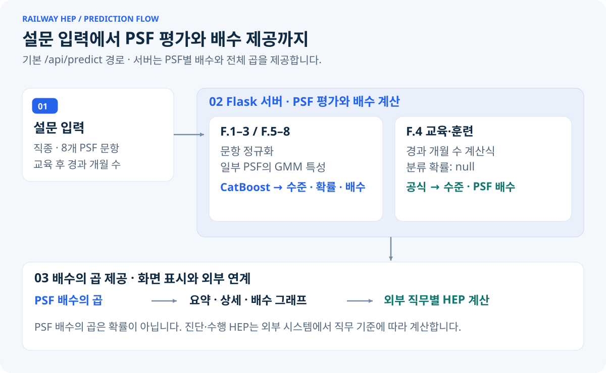
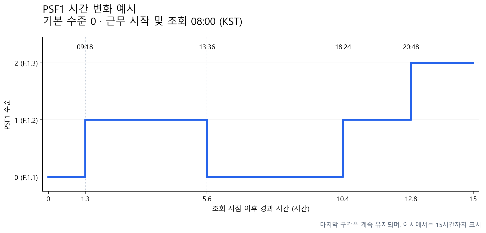
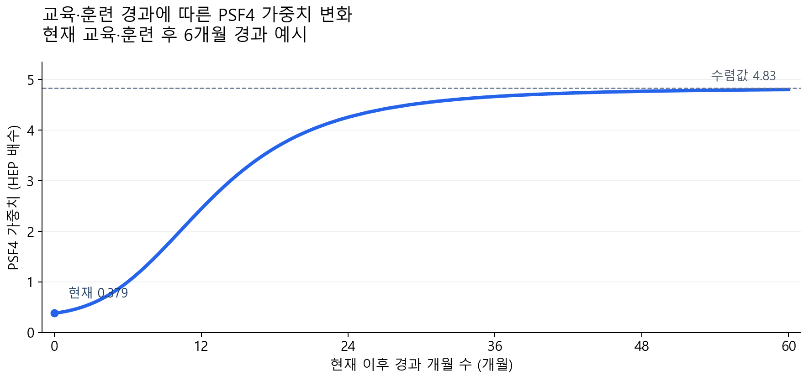

# Railway HEP — 철도 작업 PSF 평가·배수 제공

철도 작업자의 응답으로 **8개 PSF 수준과 배수를 결정**하고 **PSF 배수의 곱**을 반환하는 Flask 웹 애플리케이션입니다. 결과 요약, 항목별 분류 확률·배수, 시간별·월별 배수 변화 그래프를 제공합니다. 진단 HEP·수행 HEP·최종 HEP는 계산하거나 반환하지 않습니다. 안전·비안전 직무에 따른 HEP 선택과 계산은 외부 시스템에서 담당합니다.

현재 기본 경로는 **F.4 교육·훈련 계산식 + 나머지 PSF의 CatBoost 분류**입니다. 서버가 PSF별 배수와 전체 곱을 계산하고 브라우저가 배수로 표시합니다. PSF2·4·8의 GMM 경로와 PSF6 원변수 14개 CatBoost 경로는 유지합니다.

[전체 프로젝트](https://github.com/JungWonSeok97/Railway_Human_Error) · [설문 수집 앱](https://github.com/JungWonSeok97/survey) · [정확도 연구보고서](https://github.com/abitocodes/rail-psf-accuracy-memo)

## 목차

- [기능과 처리 흐름](#기능과-처리-흐름)
- [설치 및 실행](#설치-및-실행)
- [화면 사용 방법](#화면-사용-방법)
- [PSF 예측과 배수 계산](#psf-예측과-배수-계산)
- [시간별·월별 그래프](#시간별월별-그래프)
- [API 사용 안내](#api-사용-안내)
- [프로젝트 구조](#프로젝트-구조)
- [모델과 데이터 관리](#모델과-데이터-관리)
- [검증과 개발](#검증과-개발)
- [배포와 현재 제약](#배포와-현재-제약)
- [문제 해결](#문제-해결)

## 기능과 처리 흐름

| 기능 | 현재 동작 |
| --- | --- |
| 직종 선택 | 기관사, 관제사, 정비사, 선로작업자 |
| PSF 분석 | 설문 입력으로 수준·분류 확률 예측, F.4는 경과 개월 수 공식 |
| 배수 요약 | PSF 배수의 곱과 PSF별 배수 |
| 상세 결과 | PSF별 수준·확률 또는 공식 배수 |
| 시간별 그래프 | 조회 시점부터 24시간, 작업부하 F.1 변화 반영 |
| 월별 그래프 | 현재부터 60개월, 교육·훈련 F.4 변화 반영 |
| 그래프 조작 | 팝업, 시점 슬라이더, 입력 검증·오류 안내 |



*그림 1. 기본 예측 경로. 서버가 PSF 수준·분류 확률·배수와 배수의 곱을 반환합니다. 브라우저는 배수를 표시하고 외부 시스템은 직무별 HEP 규칙을 적용합니다.*

별도의 프런트엔드 빌드나 DB 설정은 없습니다. 이 앱은 Supabase의 설문 응답을 자동으로 읽거나 학습하지 않습니다. 별도 설문 앱과 연계하려면 추출·전처리·학습 과정을 준비해야 합니다.

## 설치 및 실행

### 준비 사항

- Python, pip, Git 및 Python 가상환경
- 저장소에 포함된 `models/*_catboost.cbm` 및 `models/gmm/*.joblib`
- 그래프 테스트를 실행하려면 Node.js

[requirements.txt](requirements.txt)는 Flask, Flask-Cors, NumPy, pandas, scikit-learn, CatBoost를 선언합니다. 패키지와 Python 버전은 고정되어 있지 않습니다. 선택한 Python·운영체제에서 설치 가능한 조합을 사용하고, 재현이 필요한 실행 환경은 별도로 기록합니다.

예측 서버는 CatBoost·scikit-learn 기반으로 실행됩니다. 코드에서 사용하는 `joblib`는 scikit-learn의 의존성으로 설치됩니다.

### 저장소 받기

```bash
git clone https://github.com/JungWonSeok97/Railway_hep.git
cd Railway_hep
```

상위 프로젝트에서 받았다면 초기화된 `Railway_hep/`로 이동합니다. 아래 명령은 이 디렉터리를 기준으로 합니다.

### Windows / PowerShell

가상환경 활성화 없이 해당 Python을 직접 실행하는 방법입니다.

```powershell
python -m venv .venv
.\.venv\Scripts\python.exe -m pip install --upgrade pip
.\.venv\Scripts\python.exe -m pip install -r requirements.txt
.\.venv\Scripts\python.exe app.py
```

가상환경을 활성화하려면 `.\.venv\Scripts\Activate.ps1` 실행 후 `python app.py`를 사용합니다.

### macOS / Linux

```bash
python3 -m venv .venv
source .venv/bin/activate
python -m pip install --upgrade pip
python -m pip install -r requirements.txt
python app.py
```

### 접속과 설정

브라우저에서 **http://127.0.0.1:8000**에 접속합니다. HTML 파일을 직접 열면 API와 정적 파일 경로가 정상 연결되지 않습니다.

| 설정 | 현재 값 / 위치 |
| --- | --- |
| 개발 서버 | `app.py`의 `0.0.0.0:8000`, `debug=True` |
| 모델 경로 | [config/paths.py](config/paths.py) |
| CatBoost 모델·특성 순서 | [config/catboost_config.py](config/catboost_config.py) |
| 문항 코드·수준 매핑 | [config/mappings.py](config/mappings.py) |
| 필수 환경 변수 | 현재 기본 실행 경로에는 없음 |
| 브라우저 저장 | `sessionStorage`, 같은 탭의 결과 조회에 사용 |

포트를 코드 수정 없이 바꿔 개발 실행하려면 가상환경에서 `python -m flask --app app run --port 8001`을 사용할 수 있습니다.

## 화면 사용 방법

1. 첫 화면에서 직종을 선택합니다.
2. 8개 PSF 문항과 마지막 직무 교육 후 경과 개월 수를 입력합니다.
3. **분석하기**를 눌러 결과 요약을 확인합니다.
4. **상세보기**에서 PSF별 결과와 배수를 확인합니다.
5. 시간별 또는 월별 예측 팝업을 열고 필요한 값을 입력해 조회합니다.
6. 슬라이더를 움직여 시점별 값을 확인합니다.
7. 팝업은 닫기 버튼·Esc·바깥 영역 클릭으로 닫고, 새 분석은 **다시 설문하기**로 시작합니다.

PSF 결과는 `psfResults`, 직종은 `selectedRole` 키로 `sessionStorage`에 저장됩니다. 서버 측 결과 저장·결과 URL 공유 기능은 없습니다. 필요한 데이터가 없으면 같은 탭에서 설문부터 진행합니다.

## PSF 예측과 배수 계산

### 예측 항목

| ID | 항목 | 기본 경로 | 수준 |
| --- | --- | --- | --- |
| F.1 | 작업부하 | CatBoost | 보통 / 나쁨 / 매우나쁨 |
| F.2 | 장비 및 기기 | GMM 특성 + CatBoost | 좋음 / 보통 / 나쁨 |
| F.3 | 절차 및 지침 | CatBoost | 좋음 / 보통 / 나쁨 |
| F.4 | 교육 및 훈련 | 경과 개월 수 공식 | 좋음 / 보통 / 나쁨 |
| F.5 | 의사소통 | CatBoost | 보통 / 나쁨 |
| F.6 | 환경 | 원래 14개 범주 + CatBoost (GMM 없음) | 보통 / 나쁨 |
| F.7 | 작업절차 | CatBoost | 좋음 / 보통 / 나쁨 |
| F.8 | 복잡성 | GMM 특성 + CatBoost | 보통 / 약간 높음 / 매우 높음 |

PSF 수준의 **분류 확률**과 **PSF 배수**는 서로 다른 값입니다. 분류 확률만 백분율로 표시하며, 개별 배수와 배수의 곱은 `배`로 표시합니다. 배수의 곱에 안전·보통·나쁨 종합 등급이나 0~1/0~2 상한을 적용하지 않습니다.

### 교육·훈련 배수

[공식 구현](predictors/psf4_formula.py)은 교육 후 경과 개월 수 `x`로 다음 배수를 계산합니다.

```text
m4(x) = 0.33 + 4.5 × ((x / 18.555)^4 / (1 + (x / 18.555)^4))
```

- `x`는 0 이상의 유한한 숫자입니다. 숫자 문자열·불리언은 허용하지 않습니다.
- 반올림 전 배수 `< 1`이면 수준 0, `1 이상 2 미만`이면 수준 1, `2 이상`이면 수준 2입니다.
- 배수는 소수점 셋째 자리로 반올림해 `psf_multiplier`로 반환합니다.
- 기본 F.4의 `probabilities`는 `null`입니다.
- 화면의 기존 교육·훈련 선택 문항과 달리 기본 F.4 계산은 `training_elapsed_months`를 사용합니다.

### PSF 배수의 곱

`predictors/psf_multipliers.py`가 수준별 배수 기준을 관리합니다. 각 PSF의 예측 코드에 해당하는 배수를 곱해 `psf_multiplier_product`로 반환합니다. 기본 F.4에는 경과 개월 수 공식에서 계산한 `psf_multiplier`를 사용하며, 아래 F.4 범주별 값은 별도 CatBoost 경로에만 적용합니다.

| PSF | 수준별 배수 |
| --- | --- |
| F.1 | 보통 1 / 나쁨 14.45 / 매우나쁨 17.54 |
| F.2 | 좋음 0.492 / 보통 1 / 나쁨 5.654 |
| F.3 | 좋음 0.292 / 보통 1 / 나쁨 8.559 |
| F.4 | 기본 경로는 공식 배수; 배수가 없는 결과의 좋음 / 보통 / 나쁨 매핑은 0.421 / 1 / 7.229 |
| F.5 | 보통 1 / 나쁨 9.559 |
| F.6 | 보통 1 / 나쁨 11.576 |
| F.7 | 좋음 0.322 / 보통 1 / 나쁨 12.11 |
| F.8 | 보통 1 / 약간 높음 4.654 / 매우 높음 11.873 |

```text
M = m1 × m2 × m3 × m4 × m5 × m6 × m7 × m8
```

예를 들어 다른 배수가 모두 1이고 교육·훈련 배수가 4.692, 환경 배수가 11.576이면 M은 54.314592배입니다. 교육·훈련 배수가 4.704가 되면 M은 54.453504배로 증가합니다. 곱이 1을 넘더라도 보정식을 바꾸거나 상한을 씌우지 않습니다. 이 값은 확률이 아닙니다.

직종별 기본 오류 확률을 곱하거나 진단·수행 값을 합산하지 않습니다. 화면의 직종 선택은 설문 맥락으로 유지하지만 배수 계산에는 사용하지 않습니다. 직무별 안전·비안전 분류와 진단/수행 HEP 선택은 외부 시스템의 책임입니다.

## 시간별·월별 그래프

| 구분 | 시간별 | 월별 |
| --- | --- | --- |
| 서버 API | `/api/psf1/predict` | `/api/psf4/forecast` |
| 입력 | 근무 시작 일시, 원본 F.1 수준 | 현재 교육 후 경과 개월 수 |
| 변화시키는 요인 | F.1 작업부하 | F.4 교육·훈련 |
| 나머지 PSF | 현재 설문 결과로 고정 | 현재 설문 결과로 고정 |
| 화면 범위 | API 조회 시점부터 24시간 | 현재부터 60개월 |
| 표현 | 시간 구간별 F.1 배수 × 나머지 7개 배수 | 0.1개월 간격 F.4 배수 601개 × 나머지 7개 배수 |

시간별 F.1은 원본 수준, 근무 경과 시간 수준, 시간대 수준 중 최댓값을 사용합니다. 경과 시간 경계는 1.3·5.6·10.6·12.8시간이고, 시간대 경계는 06:24·18:24입니다. 한국시간(UTC+09:00)을 사용하며 시간대 없는 입력도 한국시간으로 해석합니다.

그래프의 가로축 0은 **근무 시작 시각이 아니라 조회 시점**입니다. 마지막 구간의 종료값이 `null`이면 해당 수준이 계속되는 것으로 처리합니다.

월별 예측은 현재 경과 개월 수에 미래 개월 수를 더합니다. 추가 교육에 따른 초기화와 두 요인을 동시에 변화시키는 시나리오는 현재 자동 반영하지 않습니다.

### 그래프로 보는 예측 예시



*그림 2. F.1 수준 변화 예시. 근무 시작과 조회가 모두 08:00(KST)인 조건이며 15시간까지만 표시합니다. 실제 웹 그래프의 표시 범위는 조회 시점부터 24시간입니다. 세로축은 최종 HEP가 아닌 F.1 수준입니다.*



*그림 3. F.4 배수 변화 예시. 교육 후 6개월이 지난 상태에서 시작해 향후 60개월을 계산합니다. 세로축은 최종 HEP가 아닌 교육·훈련 배수입니다.*

두 그림은 저장소의 [시간별 예시 코드](output/psf1-graph-example.py)와 [월별 예시 코드](output/psf4-monthly-example.py)로 생성한 정적 자료입니다. 실제 사용자 응답이나 웹 화면 캡처가 아닙니다.

## API 사용 안내

POST 요청은 `Content-Type: application/json`을 사용합니다. 기본 API는 PSF 결과와 `psf_multiplier_product`를 반환합니다. 진단·수행·최종 HEP 필드는 없습니다.

### 경로 목록

| 메서드 | 경로 | 역할 |
| --- | --- | --- |
| GET | `/`, `/input`, `/input.html` | 설문 화면 |
| GET | `/result`, `/result.html` | 결과 요약 |
| GET | `/detail_result`, `/detail_result.html` | 상세 결과 |
| POST | `/api/predict` | 기본 일괄 예측: F.4 공식 + 나머지 CatBoost |
| POST | `/api/psf1/predict` | F.1 시간 변화 |
| POST | `/api/psf4/forecast` | F.4 월별 변화 |
| POST | `/api/predict/<psf_id>` | 단일 CatBoost 예측 |
| POST | `/api/catboost/predict`, `/api/predict/catboost` | 전체 CatBoost 경로, F.4도 모델 사용 |
| POST | `/api/catboost/predict/<psf_id>`, `/api/predict/catboost/<psf_id>` | 단일 CatBoost 경로의 별칭 |
| POST | `/api/test/predict/<psf_id>` | 모델 입력·한글 결과 확인용 |

`<psf_id>`는 1–8입니다. `/api/predict/4`는 기본 일괄 API의 F.4 공식과 다른 **CatBoost 경로**입니다.

### 기본 요청과 응답

다음은 **F.1과 F.4만 호출하는 부분 요청**입니다. 웹 화면의 전체 분석에는 F.1–F.8 결과가 모두 필요합니다.

```json
{
  "F.1": {
    "F.1.S.1": 0,
    "F.1.S.2": 0,
    "F.1.S.3": 0,
    "F.1.S.4": 0,
    "F.1.S.5": 0
  },
  "F.4": {
    "training_elapsed_months": 12
  }
}
```

최상위 키는 `F.1`–`F.8`이고 기존 `psf1`–`psf8`도 지원합니다. CatBoost 문항 값은 등록된 선택 코드를 권장합니다. PSF6은 원래 응답 문구도 지원하고, 다른 PSF는 **학습 당시 인코딩된 숫자**도 지원합니다. 숫자 문자열과 기존 `F.1.1` 형식의 문항 키·선택 코드도 지원합니다. 숫자는 보기 번호나 모든 문항에 공통인 위험 등급이 아닙니다.

### CatBoost 입력 인코딩

`config/catboost_mappings.py`는 `processed_data/subpsf_level_mapping.xlsx`를 기준으로 PSF1·2·3·4·5·7·8 및 기존 PSF6의 숫자 인코딩을 정의합니다. 현재 PSF6은 `config/environment_schema.py`의 원래 14개 응답 범주를 사용합니다. 화면의 각 선택지에는 `data-condition-code`가 명시되어 있으며, `static/input-encoding.js`가 이 코드를 읽으므로 보기 순서를 바꾸어도 같은 답변의 코드가 유지됩니다.

| 문항 | 응답 | 선택 코드 | 모델 입력값 |
| --- | --- | --- | --- |
| 수면시간 | 8시간 이상 | `F.1.S.3.3` | 0 |
| 수면시간 | 6시간 이내 | `F.1.S.3.1` | 2 |
| 장비 가용성 | 낮음 | `F.2.S.1.2` | 1 |
| 실내 온도 | 17℃ 이하 / 17~28℃ / 28℃ 이상 | `F.6.S.10.1` / `.2` / `.3` | 서로 다른 원래 응답 문자열 3개 |
| 황사 | 사물 식별 불가 / 숨쉬기 불편 | `F.6.S.7.1` / `.2` | 서로 다른 원래 응답 문자열 2개 |
| 직무능력 평가 빈도 | 6개월 / 1년 / 3년 | `F.4.S.4.1` / `.2` / `.3` | 1 / 0 / 2 |

PSF2·4·8의 CatBoost 경로는 기존 숫자 인코딩과 저장된 GMM을 유지합니다. PSF6은 선택 코드를 원래 응답 문자열로 복원해 14개 범주형 특성으로 전달합니다. 실내 온도·습도의 낮음/중간/높음을 별도 범주로 보존하며, GMM의 6개 복합 특성이나 기존의 1/0/1로 합치지 않습니다.

**PSF6 입력 계약:** 14개 문항을 모두 전달해야 합니다. 누락·다른 문항의 코드·충돌하는 별칭은 HTTP 400을 반환합니다. 기존 숫자는 원래 범주가 하나로 결정될 때만 호환합니다. 특히 실내 온도·습도 숫자 `1`은 낮음과 높음을 구별할 수 없어 거부하고, 숫자 `0`은 중간 범주로 해석합니다. 숫자 `2`를 높은 수준으로 추측하지 않습니다. 화면은 이미 선택 코드를 전송하므로 이 제약에 맞게 동작합니다.

예를 들어 `"F.6.S.10": "F.6.S.10.3"`은 실내 온도 28℃ 이상 범주를 정확히 전달합니다. 기존 `F.6.10` 문항 키와 `F.6.10.3` 선택 코드도 지원합니다. PSF6의 원문에서 강수량 단위가 `mm/s`로 기재된 범주는 학습 토큰의 일치를 위해 그대로 유지합니다. 이는 단위의 물리적 타당성을 검증했다는 뜻이 아닙니다.

`config/mappings.py`는 PSF 이름·출력 등급과 입력 키 별칭만 정의합니다. 선택 코드의 숫자 변환은 `config/catboost_mappings.py`, PSF6 원문 범주는 `config/environment_schema.py`에서 관리합니다. HEP 계산은 제거했으며 기본 F.4의 경과 개월 수 공식은 유지합니다. 서버를 재시작한 후 설문을 다시 제출해야 하며, 이전 `sessionStorage` 결과는 자동 재계산되지 않습니다.

요청에 없는 PSF는 건너뜁니다. 부분 요청에서는 개별 결과만 제공하고 `psf_multiplier_product`는 `null`, `missing_psfs`에는 빠진 PSF ID를 반환합니다. 누락된 PSF를 배수 1로 간주하지 않습니다. **PSF6은 하위 문항을 임의로 채우지 않습니다.** 다른 CatBoost PSF의 기존 하위 문항 기본값 1 처리는 유지하므로 실제 분석에서는 전체 문항을 명시합니다. 단일 CatBoost API에는 최상위 PSF 묶음 대신 해당 PSF의 문항 객체를 본문으로 전달합니다.

성공 응답은 `{"success": true, "results": [...]}`이며 단일 예측은 `result` 객체를 사용합니다.

| 결과 필드 | 의미 |
| --- | --- |
| `psf_id` | `F.1` 등의 ID |
| `predicted_label` | 0부터 시작하는 수준 번호 |
| `predicted_text` | `F.1.1` 등의 출력 코드 |
| `probabilities` | 출력 코드별 분류 확률, 기본 F.4는 `null` |
| `result.psf_multiplier` | 모든 개별 PSF의 배수. 기본 F.4는 경과 개월 수 공식 값 |
| `psf_multiplier_product` | 일괄 응답의 8개 PSF 배수 곱. 일부 PSF 누락 시 `null` |
| `missing_psfs` | 일괄 응답에서 빠진 PSF ID 목록. 전체 응답은 `[]` |

### 배수 API 변경 사항

전체 8개 PSF 요청 시 다음 필드가 추가됩니다. 아래는 배수 필드만 발췌한 예입니다. 실제 `results`에는 기존 예측 코드·수준·분류 확률도 포함됩니다.

```json
{
  "success": true,
  "results": [
    {"psf_id": "F.1", "psf_multiplier": 1.0},
    {"psf_id": "F.2", "psf_multiplier": 1.0},
    {"psf_id": "F.3", "psf_multiplier": 1.0},
    {"psf_id": "F.4", "psf_multiplier": 4.692},
    {"psf_id": "F.5", "psf_multiplier": 1.0},
    {"psf_id": "F.6", "psf_multiplier": 11.576},
    {"psf_id": "F.7", "psf_multiplier": 1.0},
    {"psf_id": "F.8", "psf_multiplier": 1.0}
  ],
  "psf_multiplier_product": 54.314592,
  "missing_psfs": []
}
```

- 기본 일괄 API와 CatBoost 일괄 API 별칭 모두 전체 곱을 반환합니다. 단일·검증 API는 해당 PSF의 `psf_multiplier`를 반환하며 전체 곱을 만들지 않습니다.
- F.4의 이전 `hep_multiplier` 필드는 `psf_multiplier`로, 월별 `series.hep_multipliers`는 `series.psf_multipliers`로 변경했습니다. 외부 클라이언트도 함께 수정해야 합니다.
- F.1 시간별 응답의 `base_prediction`, `current_prediction`, 각 `segments`에 `psf_multiplier`가 추가됩니다.
- 시간별·월별 API는 변경되는 PSF의 배수를 제공합니다. 그래프는 이 값에 현재 응답의 나머지 7개 배수를 곱합니다. 직종별 기본값이나 HEP 보정은 적용하지 않습니다.
- 이전 `sessionStorage` 결과에 새 배수 필드가 없으면 재설문을 안내합니다. 서버 재시작과 화면 새로고침 후 설문을 다시 제출합니다.
- 화면은 서버에서 받은 곱과 8개 개별 배수의 곱이 일치하는지 확인하고 `배`로 표시합니다. 원래 배수 정밀도로 계산하며 표시할 때만 유효숫자를 줄입니다.

### PowerShell 호출 예시

서버 실행 후 별도 터미널에서 월별 예측을 확인합니다.

```powershell
$body = @{ training_elapsed_months = 12 } | ConvertTo-Json
$response = Invoke-RestMethod -Method Post -Uri 'http://127.0.0.1:8000/api/psf4/forecast' -ContentType 'application/json' -Body $body
$response.series.psf_multipliers.Count  # 601
```

응답에는 `success`, `psf_id`, `training_elapsed_months`와 `series`가 있습니다. `series`는 `x_start: 0.0`, `x_end: 60.0`, `x_step: 0.1`, `psf_multipliers`를 포함합니다.

시간별 예측 예시는 다음과 같습니다.

```powershell
$body = @{
  work_started_at = (Get-Date).AddHours(-2).ToString('o')
  base_psf1 = 0
} | ConvertTo-Json
Invoke-RestMethod -Method Post -Uri 'http://127.0.0.1:8000/api/psf1/predict' -ContentType 'application/json' -Body $body
```

`base_psf1`은 정수 0/1/2, `work_started_at`은 미래가 아닌 ISO 8601 일시입니다. 응답에는 `generated_at`, `work_started_at`, `elapsed_hours`, `base_prediction`, `current_prediction`, `segments`가 있습니다. 각 구간은 시작·종료의 경과 시간과 일시, 예측 수준을 포함합니다.

### 오류 처리

```json
{
  "success": false,
  "error": "F.4.training_elapsed_months는 필수입니다."
}
```

기본·단일·CatBoost 별칭·모델 검증 API의 `ValueError`와 시간·월별 API의 입력 검증 오류는 HTTP 400, 기타 실행 오류는 500을 반환합니다. 상태 코드와 `success`·`error`를 함께 확인합니다.

## 프로젝트 구조

```text
Railway_hep/
├── app.py                       # Flask 라우트와 개발 서버
├── requirements.txt
├── input.html                   # 직종·문항 입력
├── result.html                  # 요약·PSF 배수 표시
├── detail_result.html           # 상세·PSF 배수 표시·그래프 연결
├── config/                      # 경로, 수준 코드, CatBoost 특성
├── preprocessing/
│   ├── catboost_features.py     # 공통 입력·PSF2/4/8 GMM 특성
│   └── environment_features.py  # PSF6 원래 14개 범주
├── predictors/
│   ├── catboost.py              # CatBoost 로드·예측
│   ├── psf_multipliers.py        # PSF별 배수와 전체 곱
│   ├── psf1_forecast.py          # 시간별 F.1
│   └── psf4_formula.py           # F.4 공식·월별 예측
├── models/                      # 현재 CatBoost 8개 + 이전 환경 모델, GMM 3개 + 이전 환경 GMM
├── training/train_environment_raw14.py  # PSF6 재학습·선택적 GroupKFold 평가
├── static/                      # 화면 CSS·배수 표시·forecast.js
├── static copy/                 # 디자인 참고용 CSS
├── images/                      # 화면 이미지
├── processed_data/              # 포함된 수준 매핑 XLSX 등
├── output/                      # 그래프 예시 코드·산출물
├── tests/                       # Python 모델/API·Node.js 화면/그래프 테스트
└── env_preprocess_v1.ipynb       # 환경 전처리 노트북
```

`HEP 예측 그래프 API 연동 가이드.pdf`는 참고 자료입니다. 문서와 구현이 다르면 현재 README의 배수 API 계약과 구현을 우선합니다. 이전 PDF의 HEP 계산 설명은 현재 요구사항과 다릅니다.

## 모델과 데이터 관리

- 현재 CatBoost 경로는 모델 8개와 PSF2·4·8의 GMM 번들 3개를 사용합니다. PSF6은 `models/환경_raw14_catboost.cbm`을 사용합니다. 이전 `환경_catboost.cbm`과 `gmm/psf6_gmm.joblib`은 비교·복구용으로 보존하며 현재 추론에서는 읽지 않습니다. F.4 모델과 GMM은 보조 CatBoost 경로에서 사용합니다.
- 모델은 최초 사용 시 로드되고 메모리에 캐시됩니다. 교체 후에는 서버를 재시작합니다.
- CatBoost 특성 이름·순서, 클래스, GMM 번들 구조가 설정과 일치해야 합니다. PSF6은 모델 안의 입력 스키마 버전·해시도 검증하므로 같은 열 이름을 쓰는 숫자 인코딩 모델로 잘못 교체할 수 없습니다.
- `.gitignore`는 일부 원본 CSV 경로, Python 캐시, 가상환경, 환경 변수 등을 제외합니다. 모든 데이터·학습 산출물을 자동 제외하지는 않으므로 `git status`를 확인합니다.

### PSF6 원변수 모델 재학습

```bash
python -B training/train_environment_raw14.py --cross-validate
```

`철도_코레일 종사자 설문조사 결과.txt`와 `CatBoost_Result/preprocess_v1.4.ipynb`가 필요합니다. 스크립트는 해시로 고정한 노트북의 지정된 전처리 셀만 읽어 기존 `quality_95 == 성실` 기준을 재현합니다. 원본, 노트북, 기존 모델을 수정하지 않습니다. 노트북이 변경되면 지정 셀을 검토하기 전에는 실행을 중단합니다.

원본 설문과 `CatBoost_Result/`의 로컬 분석 노트북은 이 저장소의 배포 파일에 포함하지 않습니다. 재학습하려면 승인된 원본 자료를 위 경로에 별도로 준비해야 합니다. 포함된 모델을 이용한 추론과 회귀 테스트에는 이 원본 자료가 필요하지 않습니다.

CatBoost 설정은 기존 비교 실험과 같은 500회, depth 6, learning rate 0.05, random seed 42이며 전체 설정·라이브러리 버전·원본 해시를 `models/environment_raw14_metadata.json`에 기록합니다. 모든 14개 특성은 문자열 범주형입니다. 가중치나 분류 임계값은 바꾸지 않습니다. `--cross-validate`를 생략하면 교차검증 없이 최종 모델만 학습하고 보고서를 새로 작성합니다. 다른 위치에서 검토하려면 `--output-dir <경로>`를 사용합니다. 재학습은 위 CLI 명령으로 수행합니다.

2026-11-18 재현 결과는 다음과 같습니다. 실제 응답은 보통 805건·나쁨 2,145건이고, 응답 2,950건에는 서로 다른 원래 시나리오 2,762개가 있습니다.

| 평가 구분 | 보통 예측 | 나쁨 예측 | 해석 |
| --- | ---: | ---: | --- |
| 전체 데이터로 학습한 저장 모델 → 학습 데이터 재예측 | 64건 (2.17%) | 2,886건 (97.83%) | 학습 내 결과, 일반화 성능 아님 |
| 원래 시나리오 기준 5-fold GroupKFold OOF | 132건 (4.47%) | 2,818건 (95.53%) | 해당 시나리오를 학습에서 제외한 예측 |

위 비율은 응답 건수 기준이며 모든 가능한 입력 조합의 비율이 아닙니다. 교차검증에서는 동일한 14개 원변수 조합을 같은 그룹에 넣고 `shuffle=False`로 분할합니다. 응답자 단위 분리나 외부 검증은 아닙니다. OOF 보통 재현율은 **6.71%**, 균형 정확도는 **51.54%**여서 원변수 적용만으로 편향이나 분류 성능 문제가 해결됐다고 볼 수 없습니다. 학습 데이터에는 안개·낙뢰의 ‘발생하지 않은 경우’가 없어 해당 범주의 효과를 검증할 수 없으며, 미관측 범주도 메타데이터에 기록합니다.

## 검증과 개발

### 기존 그래프 테스트

프로젝트 루트에서 실행합니다. npm 패키지 설치는 필요하지 않습니다.

```bash
node --test tests/*.test.cjs
```

월별 601개 배수, 시간 구간, 다른 PSF 유지, 팝업·입력 오류, 실제 결과 화면 스크립트의 배수 표시와 이전 응답 거부를 확인합니다. M=54→55와 교육 후 44→45개월에서 이전 HEP 역전 현상이 발생하지 않는지도 검증합니다. Python 테스트는 실제 모델을 사용하는 일괄·단일·검증 API, 부분 응답, 예측 API의 배수 필드와 HEP 필드 부재를 확인합니다.

### 입력 인코딩 회귀 검증

```bash
python -B -m unittest discover -s tests -p "test_*.py" -v
node --test tests/input-encoding.test.cjs
```

57개 문항의 157개 화면 선택지를 XLSX 기준표와 대조하고, 선택 코드·기존 별칭·숫자 입력 검증 및 PSF2·4·8의 실제 GMM 특성 생성을 확인합니다. PSF6의 32개 선택지는 원문 문자열·14개 특성 순서와 별도로 대조하며, 온도·습도 세 수준 보존, GMM 미사용, 저장 모델의 입력 스키마, 모든 예측 API 별칭의 두 클래스 출력과 오류 응답을 검증합니다. 화면 코드 검증은 선택지 순서·문구 변경에도 코드가 유지되는지 확인합니다. XLSX는 테스트에서 Python 표준 라이브러리로 읽으며, 모델 전처리 테스트에는 프로젝트의 Python 의존성이 필요합니다.

### 기능 확인 순서

1. `/`에서 화면·CSS·이미지가 로드되는지 확인합니다.
2. 전체 설문을 제출하고 8개 PSF 결과와 배수의 곱을 확인합니다.
3. 상세 화면에서 F.4 배수와 다른 PSF 분류 확률을 확인합니다.
4. 시간별·월별 팝업을 각각 조회하고 슬라이더·닫기를 확인합니다.
5. 잘못된 경과 개월 수·근무 시작 시각에 대한 오류를 확인합니다.

| 변경 대상 | 함께 확인할 파일 |
| --- | --- |
| 문항·코드 | `input.html`, `static/input-encoding.js`, `config/catboost_mappings.py`, `config/environment_schema.py`, 매핑 XLSX·특성 정의·전처리 |
| 모델·특성 | `models/`, `config/catboost_config.py`, `preprocessing/` |
| PSF 배수·곱 | `predictors/psf_multipliers.py`, `static/psf-multipliers.js`, API·화면·그래프 테스트 |
| 시간·월별 예측 | 두 예측 모듈, `app.py`, `static/forecast.js` |
| UI | HTML, `static/`, `images/` |

## 배포와 현재 제약

기본 실행은 Flask 개발 서버입니다. 운영용 WSGI 서버, 인증, CI·배포 설정, Python 의존성 잠금은 별도로 구성해야 합니다.

- 운영에서는 디버그 모드를 끄고 배포 서버의 진입점으로 `app:app`을 사용합니다.
- 모델 파일을 배포 패키지에 포함하고 지연 로딩에 필요한 메모리·최초 요청 시간을 확인합니다.
- `CORS(app)`가 적용되어 있고 API 인증은 없습니다. 공개 서비스에서는 접근 범위와 기존 재학습 경로의 노출을 검토합니다.
- 서버 DB, 사용자 계정, 자동 모델 학습은 현재 기능에 포함되지 않습니다.
- 공식·배수·표시 단위는 현재 코드의 구현이며 보고서의 지표·실험 조건과 동일하다고 가정하지 않습니다.

## 문제 해결

| 증상 | 확인할 사항 |
| --- | --- |
| CatBoost 설치 실패 | Python·OS·패키지 조합 확인. 고정 버전이 없음 |
| 모듈을 찾지 못함 | 설치에 사용한 가상환경 Python으로 실행했는지 확인 |
| CSS·이미지·API 오류 | HTML 직접 열기 대신 Flask 주소 사용 |
| 결과 데이터가 없음 | 같은 탭에서 설문 진행, `sessionStorage` 확인 |
| F.4 입력 오류 | 숫자형 `training_elapsed_months` 전달 여부 |
| 시간별 조회 오류 | ISO 일시, 미래 여부, `base_psf1` 정수 범위 |
| 모델·특성 불일치 | 파일과 설정·전처리·직렬화 환경 비교 |
| GMM 버전 경고 | 저장 당시와 현재 scikit-learn 환경 비교 |
| 포트 8000 사용 중 | 기존 서버 확인 또는 Flask CLI로 다른 포트 지정 |

이슈에는 재현 입력, 요청 경로, 오류 메시지, Python·주요 패키지 버전을 기록합니다. 실제 참여자의 개인정보나 학습 원본은 예제 요청에 넣지 않습니다.
