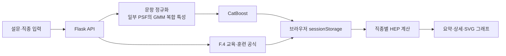

# Railway HEP — 철도 작업 PSF·인적 오류 예측

철도 작업자의 응답으로 **8개 PSF 수준을 예측**하고, 직종별 계수와 PSF 배수로 **진단·수행·최종 HEP**를 계산하는 Flask 웹 애플리케이션입니다. 결과 요약, 항목별 상세 결과, 시간별·월별 변화 그래프를 제공합니다.

현재 기본 경로는 **F.4 교육·훈련 계산식 + 나머지 PSF의 CatBoost 분류**입니다. 서버가 PSF를 예측하고 브라우저가 HEP를 계산합니다.

[전체 프로젝트](https://github.com/JungWonSeok97/Railway_Human_Error) · [설문 수집 앱](https://github.com/JungWonSeok97/survey) · [정확도 연구보고서](https://github.com/abitocodes/rail-psf-accuracy-memo)

## 목차

- [기능과 처리 흐름](#기능과-처리-흐름)
- [설치 및 실행](#설치-및-실행)
- [화면 사용 방법](#화면-사용-방법)
- [PSF 예측과 HEP 계산](#psf-예측과-hep-계산)
- [시간별·월별 그래프](#시간별월별-그래프)
- [API 사용 안내](#api-사용-안내)
- [프로젝트 구조](#프로젝트-구조)
- [모델과 데이터 관리](#모델과-데이터-관리)
- [검증과 개발](#검증과-개발)
- [배포와 현재 제약](#배포와-현재-제약)
- [문제 해결](#문제-해결)

## 기능과 처리 흐름

| 기능 | 현재 동작 |
| --- | --- |
| 직종 선택 | 기관사, 관제사, 정비사, 선로작업자 |
| PSF 분석 | 설문 입력으로 수준·분류 확률 예측, F.4는 경과 개월 수 공식 |
| HEP 요약 | 진단·수행·최종 HEP와 게이지 |
| 상세 결과 | PSF별 수준·확률 또는 공식 배수 |
| 시간별 그래프 | 조회 시점부터 24시간, 작업부하 F.1 변화 반영 |
| 월별 그래프 | 현재부터 60개월, 교육·훈련 F.4 변화 반영 |
| 그래프 조작 | 팝업, 시점 슬라이더, 입력 검증·오류 안내 |



별도의 프런트엔드 빌드나 DB 설정은 없습니다. 이 앱은 Supabase의 설문 응답을 자동으로 읽거나 학습하지 않습니다. 별도 설문 앱과 연계하려면 추출·전처리·학습 과정을 준비해야 합니다.

## 설치 및 실행

### 준비 사항

- Python, pip, Git 및 Python 가상환경
- 저장소에 포함된 `models/*_catboost.cbm` 및 `models/gmm/*.joblib`
- 그래프 테스트를 실행하려면 Node.js

[requirements.txt](requirements.txt)는 Flask, Flask-Cors, NumPy, pandas, scikit-learn, CatBoost, TensorFlow를 선언합니다. 패키지와 Python 버전은 고정되어 있지 않습니다. 선택한 Python·운영체제에서 설치 가능한 조합을 사용하고, 재현이 필요한 실행 환경은 별도로 기록합니다.

기본 예측이 CatBoost를 사용하더라도 `app.py`가 CNN 모듈을 가져오므로 **현재 구성에서는 TensorFlow도 필요**합니다. 코드에서 사용하는 `joblib`는 scikit-learn의 의존성으로 설치됩니다.

### 저장소 받기

```bash
git clone https://github.com/JungWonSeok97/Railway_hep.git
cd Railway_hep
```

상위 프로젝트에서 받았다면 초기화된 `Railway_hep/`로 이동합니다. 아래 명령은 이 디렉터리를 기준으로 합니다.

### Windows / PowerShell

가상환경 활성화 없이 해당 Python을 직접 실행하는 방법입니다.

```powershell
python -m venv .venv
.\.venv\Scripts\python.exe -m pip install --upgrade pip
.\.venv\Scripts\python.exe -m pip install -r requirements.txt
.\.venv\Scripts\python.exe app.py
```

가상환경을 활성화하려면 `.\.venv\Scripts\Activate.ps1` 실행 후 `python app.py`를 사용합니다.

### macOS / Linux

```bash
python3 -m venv .venv
source .venv/bin/activate
python -m pip install --upgrade pip
python -m pip install -r requirements.txt
python app.py
```

### 접속과 설정

브라우저에서 **http://127.0.0.1:8000**에 접속합니다. HTML 파일을 직접 열면 API와 정적 파일 경로가 정상 연결되지 않습니다.

| 설정 | 현재 값 / 위치 |
| --- | --- |
| 개발 서버 | `app.py`의 `0.0.0.0:8000`, `debug=True` |
| 모델 경로 | [config/paths.py](config/paths.py) |
| CatBoost 모델·특성 순서 | [config/catboost_config.py](config/catboost_config.py) |
| 문항 코드·수준 매핑 | [config/mappings.py](config/mappings.py) |
| 필수 환경 변수 | 현재 기본 실행 경로에는 없음 |
| 브라우저 저장 | `sessionStorage`, 같은 탭의 결과 조회에 사용 |

포트를 코드 수정 없이 바꿔 개발 실행하려면 가상환경에서 `python -m flask --app app run --port 8001`을 사용할 수 있습니다.

## 화면 사용 방법

1. 첫 화면에서 직종을 선택합니다.
2. 8개 PSF 문항과 마지막 직무 교육 후 경과 개월 수를 입력합니다.
3. **분석하기**를 눌러 결과 요약을 확인합니다.
4. **상세보기**에서 PSF별 결과와 HEP를 확인합니다.
5. 시간별 또는 월별 예측 팝업을 열고 필요한 값을 입력해 조회합니다.
6. 슬라이더를 움직여 시점별 값을 확인합니다.
7. 팝업은 닫기 버튼·Esc·바깥 영역 클릭으로 닫고, 새 분석은 **다시 설문하기**로 시작합니다.

PSF 결과는 `psfResults`, 직종은 `selectedRole` 키로 `sessionStorage`에 저장됩니다. 서버 측 결과 저장·결과 URL 공유 기능은 없습니다. 필요한 데이터가 없으면 같은 탭에서 설문부터 진행합니다.

## PSF 예측과 HEP 계산

### 예측 항목

| ID | 항목 | 기본 경로 | 수준 |
| --- | --- | --- | --- |
| F.1 | 작업부하 | CatBoost | 보통 / 나쁨 / 매우나쁨 |
| F.2 | 장비 및 기기 | GMM 특성 + CatBoost | 좋음 / 보통 / 나쁨 |
| F.3 | 절차 및 지침 | CatBoost | 좋음 / 보통 / 나쁨 |
| F.4 | 교육 및 훈련 | 경과 개월 수 공식 | 좋음 / 보통 / 나쁨 |
| F.5 | 의사소통 | CatBoost | 보통 / 나쁨 |
| F.6 | 환경 | GMM 특성 + CatBoost | 보통 / 나쁨 |
| F.7 | 작업절차 | CatBoost | 좋음 / 보통 / 나쁨 |
| F.8 | 복잡성 | GMM 특성 + CatBoost | 보통 / 약간 높음 / 매우 높음 |

PSF 수준의 **분류 확률**, F.4의 **HEP 배수**, 최종 **HEP 계산값**은 서로 다른 값입니다. 분류 확률을 인적 오류 확률로 그대로 해석하지 않습니다.

### 교육·훈련 배수

[공식 구현](predictors/psf4_formula.py)은 교육 후 경과 개월 수 `x`로 다음 배수를 계산합니다.

```text
m4(x) = 0.33 + 4.5 × ((x / 18.555)^4 / (1 + (x / 18.555)^4))
```

- `x`는 0 이상의 유한한 숫자입니다. 숫자 문자열·불리언은 허용하지 않습니다.
- 반올림 전 배수 `< 1`이면 수준 0, `1 이상 2 미만`이면 수준 1, `2 이상`이면 수준 2입니다.
- 배수는 소수점 셋째 자리로 반올림해 `hep_multiplier`로 반환합니다.
- 기본 F.4의 `probabilities`는 `null`입니다.
- 화면의 기존 교육·훈련 선택 문항과 달리 기본 F.4 계산은 `training_elapsed_months`를 사용합니다.

### 직종별 계수와 보정

| 직종 | 진단 기본 계수 d | 수행 기본 계수 e |
| --- | ---: | ---: |
| 기관사 | 0.01225 | 0.00615 |
| 관제사 | 0.0055 | 0.00352 |
| 정비사 | 0.00279 | 0.00347 |
| 선로작업자 | 0.01225 | 0.0035 |

각 PSF 수준을 배수로 바꾸고 모두 곱한 값을 `M`으로 사용합니다. 기본 F.4에는 예측 응답의 `hep_multiplier`를 적용합니다.

| PSF | 수준별 배수 |
| --- | --- |
| F.1 | 보통 1 / 나쁨 14.45 / 매우나쁨 17.54 |
| F.2 | 좋음 0.492 / 보통 1 / 나쁨 5.654 |
| F.3 | 좋음 0.292 / 보통 1 / 나쁨 8.559 |
| F.4 | 기본 경로는 공식 배수; 배수가 없는 결과의 좋음 / 보통 / 나쁨 매핑은 0.421 / 1 / 7.229 |
| F.5 | 보통 1 / 나쁨 9.559 |
| F.6 | 보통 1 / 나쁨 11.576 |
| F.7 | 좋음 0.322 / 보통 1 / 나쁨 12.11 |
| F.8 | 보통 1 / 약간 높음 4.654 / 매우 높음 11.873 |

```text
진단 HEP = d × M
수행 HEP = e × M
최종 HEP = 진단 HEP + 수행 HEP

위 합계가 1을 초과하면:
진단 HEP = (d × M) / (d × (M - 1) + 1)
수행 HEP = (e × M) / (e × (M - 1) + 1)
최종 HEP = 보정한 진단 HEP + 보정한 수행 HEP
```

이 설명은 현재 [result.html](result.html)과 [detail_result.html](detail_result.html)의 구현을 문서화한 것입니다. 두 계산 구현은 함께 관리해야 합니다.

**현재 표시·범위 제약:** 보정 후 합계에 1 상한을 적용하지 않습니다. 그래프는 계산값에 100을 곱하지 않으며, 상세 화면 일부에는 백분율 변환 없이 `%` 표기가 붙습니다. 다른 시스템으로 값을 옮길 때에는 이 단위·범위 차이를 확인합니다.

## 시간별·월별 그래프

| 구분 | 시간별 | 월별 |
| --- | --- | --- |
| 서버 API | `/api/psf1/predict` | `/api/psf4/forecast` |
| 입력 | 근무 시작 일시, 원본 F.1 수준 | 현재 교육 후 경과 개월 수 |
| 변화시키는 요인 | F.1 작업부하 | F.4 교육·훈련 |
| 나머지 PSF | 현재 설문 결과로 고정 | 현재 설문 결과로 고정 |
| 화면 범위 | API 조회 시점부터 24시간 | 현재부터 60개월 |
| 표현 | 시간 구간별 수준을 HEP로 변환 | 0.1개월 간격 601개 배수를 HEP로 변환 |

시간별 F.1은 원본 수준, 근무 경과 시간 수준, 시간대 수준 중 최댓값을 사용합니다. 경과 시간 경계는 1.3·5.6·10.6·12.8시간이고, 시간대 경계는 06:24·18:24입니다. 한국시간(UTC+09:00)을 사용하며 시간대 없는 입력도 한국시간으로 해석합니다.

그래프의 가로축 0은 **근무 시작 시각이 아니라 조회 시점**입니다. 마지막 구간의 종료값이 `null`이면 해당 수준이 계속되는 것으로 처리합니다.

월별 예측은 현재 경과 개월 수에 미래 개월 수를 더합니다. 추가 교육에 따른 초기화와 두 요인을 동시에 변화시키는 시나리오는 현재 자동 반영하지 않습니다.

## API 사용 안내

POST 요청은 `Content-Type: application/json`을 사용합니다. 기본 API는 PSF 결과를 반환하며 최종 HEP는 반환하지 않습니다.

### 경로 목록

| 메서드 | 경로 | 역할 |
| --- | --- | --- |
| GET | `/`, `/input`, `/input.html` | 설문 화면 |
| GET | `/result`, `/result.html` | 결과 요약 |
| GET | `/detail_result`, `/detail_result.html` | 상세 결과 |
| POST | `/api/predict` | 기본 일괄 예측: F.4 공식 + 나머지 CatBoost |
| POST | `/api/psf1/predict` | F.1 시간 변화 |
| POST | `/api/psf4/forecast` | F.4 월별 변화 |
| POST | `/api/predict/<psf_id>` | 단일 CatBoost 예측 |
| POST | `/api/catboost/predict`, `/api/predict/catboost` | 전체 CatBoost 경로, F.4도 모델 사용 |
| POST | `/api/catboost/predict/<psf_id>`, `/api/predict/catboost/<psf_id>` | 단일 CatBoost 경로의 별칭 |
| POST | `/api/test/predict/<psf_id>` | 모델 입력·한글 결과 확인용 |
| GET | `/api/model-status` | 기존 CNN 모델 상태 |
| POST | `/api/retrain` | 기존 CNN 모델 삭제 후 재학습 |

`<psf_id>`는 1–8입니다. `/api/predict/4`는 기본 일괄 API의 F.4 공식과 다른 **CatBoost 경로**입니다. CNN 관리 경로는 CatBoost 모델을 조회·갱신하는 API가 아닙니다.

### 기본 요청과 응답

다음은 **F.1과 F.4만 호출하는 부분 요청**입니다. 웹 화면의 전체 분석에는 F.1–F.8 결과가 모두 필요합니다.

```json
{
  "F.1": {
    "F.1.S.1": 0,
    "F.1.S.2": 0,
    "F.1.S.3": 0,
    "F.1.S.4": 0,
    "F.1.S.5": 0
  },
  "F.4": {
    "training_elapsed_months": 12
  }
}
```

최상위 키는 `F.1`–`F.8`이고 기존 `psf1`–`psf8`도 지원합니다. CatBoost 문항 값은 0/1/2, 숫자 문자열 또는 등록된 선택 코드를 사용할 수 있습니다. 문항 키는 기존 `F.1.1` 형식도 지원합니다. 정확한 코드와 모델 특성은 `config/`를 확인합니다.

요청에 없는 PSF는 건너뜁니다. CatBoost 하위 문항 누락 시에는 전처리 기본값 1이 사용되므로 실제 분석에서는 전체 문항을 명시합니다. 단일 CatBoost API에는 위 최상위 묶음 대신 해당 PSF의 문항 객체를 본문으로 전달합니다.

성공 응답은 `{"success": true, "results": [...]}`이며 단일 예측은 `result` 객체를 사용합니다.

| 결과 필드 | 의미 |
| --- | --- |
| `psf_id` | `F.1` 등의 ID |
| `predicted_label` | 0부터 시작하는 수준 번호 |
| `predicted_text` | `F.1.1` 등의 출력 코드 |
| `probabilities` | 출력 코드별 분류 확률, 기본 F.4는 `null` |
| `hep_multiplier` | 기본 F.4에서 계산한 배수 |

### PowerShell 호출 예시

서버 실행 후 별도 터미널에서 월별 예측을 확인합니다.

```powershell
$body = @{ training_elapsed_months = 12 } | ConvertTo-Json
$response = Invoke-RestMethod -Method Post -Uri 'http://127.0.0.1:8000/api/psf4/forecast' -ContentType 'application/json' -Body $body
$response.series.hep_multipliers.Count  # 601
```

응답에는 `success`, `psf_id`, `training_elapsed_months`와 `series`가 있습니다. `series`는 `x_start: 0.0`, `x_end: 60.0`, `x_step: 0.1`, `hep_multipliers`를 포함합니다.

시간별 예측 예시는 다음과 같습니다.

```powershell
$body = @{
  work_started_at = (Get-Date).AddHours(-2).ToString('o')
  base_psf1 = 0
} | ConvertTo-Json
Invoke-RestMethod -Method Post -Uri 'http://127.0.0.1:8000/api/psf1/predict' -ContentType 'application/json' -Body $body
```

`base_psf1`은 정수 0/1/2, `work_started_at`은 미래가 아닌 ISO 8601 일시입니다. 응답에는 `generated_at`, `work_started_at`, `elapsed_hours`, `base_prediction`, `current_prediction`, `segments`가 있습니다. 각 구간은 시작·종료의 경과 시간과 일시, 예측 수준을 포함합니다.

### 오류 처리

```json
{
  "success": false,
  "error": "F.4.training_elapsed_months는 필수입니다."
}
```

기본 API의 `ValueError`와 시간·월별 API의 입력 검증 오류는 HTTP 400, 기타 실행 오류는 500을 반환합니다. 단일 CatBoost 등 보조 경로는 입력 오류도 500으로 반환할 수 있습니다. 상태 코드와 `success`·`error`를 함께 확인합니다.

## 프로젝트 구조

```text
Railway_hep/
├── app.py                       # Flask 라우트와 개발 서버
├── requirements.txt
├── input.html                   # 직종·문항 입력
├── result.html                  # 요약·HEP 계산
├── detail_result.html           # 상세·HEP 계산·그래프 연결
├── config/                      # 경로, 수준 코드, CatBoost 특성
├── preprocessing/
│   └── catboost_features.py     # 입력 정규화·GMM 특성
├── predictors/
│   ├── catboost.py              # CatBoost 로드·예측
│   ├── psf1_forecast.py          # 시간별 F.1
│   ├── psf4_formula.py           # F.4 공식·월별 예측
│   └── cnn.py                   # 기존 CNN 학습·예측
├── models/                      # CatBoost 8개, gmm/ 번들 4개
├── static/                      # 실제 화면 CSS·forecast.js
├── static copy/                 # 디자인 참고용 CSS
├── images/                      # 화면 이미지
├── processed_data/              # 포함된 수준 매핑 XLSX 등
├── output/                      # 그래프 예시 코드·산출물
├── tests/forecast.test.cjs       # 기존 Node.js 테스트
├── env_preprocess_v1.ipynb       # 환경 전처리 노트북
└── saved_models/                # 실행 시 생성되는 기존 CNN 모델 경로
```

`HEP 예측 그래프 API 연동 가이드.pdf`는 참고 자료입니다. 문서와 구현이 다르면 현재 API 응답 및 HTML 계산식을 확인합니다.

## 모델과 데이터 관리

- CatBoost 모델 8개와 GMM 번들 4개가 포함되어 있습니다. F.4 모델과 GMM은 보조 CatBoost 경로에서 사용합니다.
- 모델은 최초 사용 시 로드되고 메모리에 캐시됩니다. 교체 후에는 서버를 재시작합니다.
- CatBoost 특성 이름·순서, 클래스, GMM 번들 구조가 설정과 일치해야 합니다. 모델 교체 시 전처리도 확인합니다.
- 학습 원본 `4.20 설문조사 결과.txt`는 포함되어 있지 않습니다. 기존 CNN 학습은 `config/paths.py`의 이 경로를 요구합니다.
- `/api/retrain`은 기존 CNN 파일을 삭제한 뒤 학습하므로 단순 실행 확인용 호출로 사용하지 않습니다.
- `/api/model-status`는 CNN 상태만 다룹니다. CNN 파일은 있지만 원본 데이터가 없으면 수정 시각 비교에서 오류가 날 수 있습니다.
- `.gitignore`는 일부 원본 CSV 경로, Python 캐시, 가상환경, 환경 변수 등을 제외합니다. 모든 데이터·학습 산출물을 자동 제외하지는 않으므로 `git status`를 확인합니다.

## 검증과 개발

### 기존 그래프 테스트

프로젝트 루트에서 실행합니다. npm 패키지 설치는 필요하지 않습니다.

```bash
node --test tests/forecast.test.cjs
```

월별 601개 값 처리, HEP 계산, 시간 구간, 다른 PSF 유지, 팝업 동작·입력·API 오류 처리 등을 확인합니다. 실제 모델 정확도, 모든 Flask 경로, 브라우저 전체 동작까지 검증하는 테스트는 아닙니다.

### 기능 확인 순서

1. `/`에서 화면·CSS·이미지가 로드되는지 확인합니다.
2. 전체 설문을 제출하고 8개 PSF 결과와 HEP를 확인합니다.
3. 상세 화면에서 F.4 배수와 다른 PSF 분류 확률을 확인합니다.
4. 시간별·월별 팝업을 각각 조회하고 슬라이더·닫기를 확인합니다.
5. 잘못된 경과 개월 수·근무 시작 시각에 대한 오류를 확인합니다.

| 변경 대상 | 함께 확인할 파일 |
| --- | --- |
| 문항·코드 | `input.html`, `config/mappings.py`, 특성 정의·전처리 |
| 모델·특성 | `models/`, `config/catboost_config.py`, `preprocessing/` |
| HEP 계수·배수 | `result.html`, `detail_result.html`, 관련 그래프 테스트 |
| 시간·월별 예측 | 두 예측 모듈, `app.py`, `static/forecast.js` |
| UI | HTML, `static/`, `images/` |

## 배포와 현재 제약

기본 실행은 Flask 개발 서버입니다. 운영용 WSGI 서버, 인증, CI·배포 설정, Python 의존성 잠금은 별도로 구성해야 합니다.

- 운영에서는 디버그 모드를 끄고 배포 서버의 진입점으로 `app:app`을 사용합니다.
- 모델 파일을 배포 패키지에 포함하고 지연 로딩에 필요한 메모리·최초 요청 시간을 확인합니다.
- `CORS(app)`가 적용되어 있고 API 인증은 없습니다. 공개 서비스에서는 접근 범위와 기존 재학습 경로의 노출을 검토합니다.
- 서버 DB, 사용자 계정, 자동 모델 학습은 현재 기능에 포함되지 않습니다.
- 공식·배수·표시 단위는 현재 코드의 구현이며 보고서의 지표·실험 조건과 동일하다고 가정하지 않습니다.

## 문제 해결

| 증상 | 확인할 사항 |
| --- | --- |
| TensorFlow·CatBoost 설치 실패 | Python·OS·패키지 조합 확인. 고정 버전이 없음 |
| 모듈을 찾지 못함 | 설치에 사용한 가상환경 Python으로 실행했는지 확인 |
| CSS·이미지·API 오류 | HTML 직접 열기 대신 Flask 주소 사용 |
| 결과 데이터가 없음 | 같은 탭에서 설문 진행, `sessionStorage` 확인 |
| F.4 입력 오류 | 숫자형 `training_elapsed_months` 전달 여부 |
| 시간별 조회 오류 | ISO 일시, 미래 여부, `base_psf1` 정수 범위 |
| 모델·특성 불일치 | 파일과 설정·전처리·직렬화 환경 비교 |
| GMM 버전 경고 | 저장 당시와 현재 scikit-learn 환경 비교 |
| CNN API 실패 | 학습 원본·CNN 파일 확인. 기본 CatBoost 경로와 구분 |
| 포트 8000 사용 중 | 기존 서버 확인 또는 Flask CLI로 다른 포트 지정 |

이슈에는 재현 입력, 요청 경로, 오류 메시지, Python·주요 패키지 버전을 기록합니다. 실제 참여자의 개인정보나 학습 원본은 예제 요청에 넣지 않습니다.
